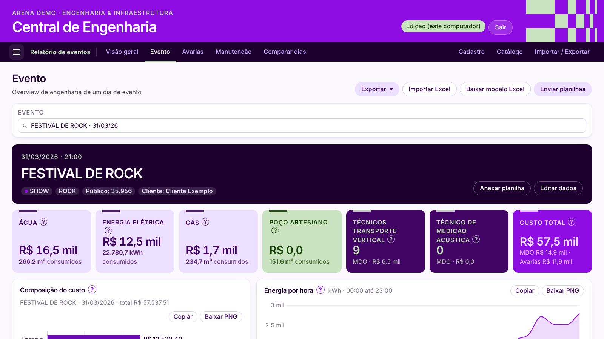
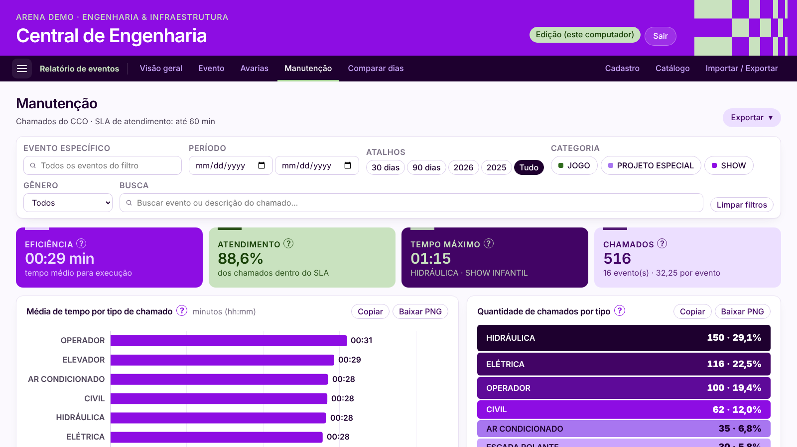
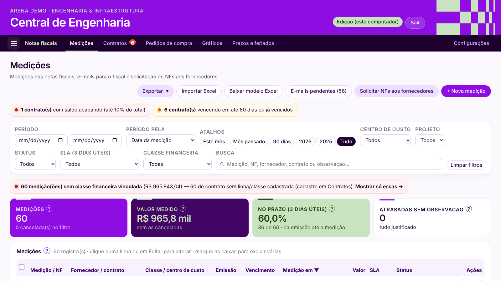
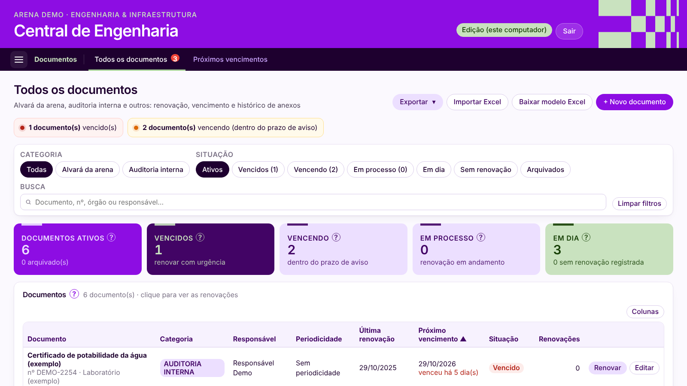

# Central de Engenharia

Sistema web interno para a área de Engenharia de uma arena de eventos (shows e jogos). Ele substitui planilhas, macros VBA e controles manuais: custos de cada evento, chamados de manutenção, medições de notas fiscais, budget, contas de consumo e vencimento de documentos ficam num lugar só, com painéis, filtros e exportação para Excel e PDF.

> ⚠️ **Versão de demonstração.** Todos os dados deste repositório são **fictícios** (eventos, valores, fornecedores, contratos, documentos e códigos internos). Nenhum dado real da empresa foi publicado. O banco é criado na sua máquina pelo `seed_demo.py`.


## O problema

Os dados de custo de cada evento (mão de obra, avarias e consumo de água, energia e gás) ficavam numa planilha com macros que só uma pessoa sabia operar. As medições de notas fiscais, o budget e os prazos de documentos (alvará, laudos, auditoria) ficavam em outras planilhas. Montar o relatório pós-evento ou responder "quanto custou esse show?" levava horas.

## O que o sistema faz

| Módulo | Principais telas |
|---|---|
| **Relatório de eventos** | Visão geral com KPIs de custo, avarias por item e evento, overview de um dia de evento (consumos, curva de energia por hora, chamados), manutenção (SLA, tempo médio, chamados por tipo e horário) e comparação entre dois dias |
| **Notas fiscais** | Medições de NF por contrato, saldo e vencimento de contratos, pedidos de compra, prazos e feriados, e geração dos e-mails para o fiscal e para os fornecedores |
| **Budget** | Previsto × incorrido por centro de custo, projeto e classe financeira, com realocações e rateio de NFs |
| **Suprimentos (consumo)** | Rateio mensal das contas de energia, água e gás entre centros de custo, com tarifas e planilhas de importação |
| **Vencimento de documentos** | Alvarás, laudos e certificados com data de vencimento, aviso antecipado e histórico de renovações |

Além dos módulos:
- **Importação de planilhas:** o sistema reconhece os modelos pelos títulos das colunas, não por posição fixa.
- **Exportação:** Excel com fórmulas e relatório em PDF (A4 paisagem) já com os filtros da tela.
- **Contas da equipe:** perfis Editor e Administrador, acesso por módulo e histórico de alterações (quem fez o quê e quando).
- **Acesso:** quem abre no próprio computador do servidor edita sem senha. Pela rede, todos só visualizam, a menos que entrem com usuário e senha.

| Evento | Manutenção |
|---|---|
|  |  |
| **Notas fiscais** | **Documentos** |
|  |  |

## Stack

- **Back-end:** Python 3.10+, Flask, SQLite e Waitress (servidor para a rede)
- **Front-end:** HTML, CSS e JavaScript puro (sem framework), Chart.js
- **Planilhas:** openpyxl e python-calamine (leitura rápida de .xlsx/.xlsm)

## Como rodar

### Opção 1: Windows, com dois cliques

1. Instale o **Python 3.10 ou mais novo** em [python.org](https://www.python.org/downloads/). Na instalação, marque **"Add Python to PATH"**.
2. Baixe este repositório: botão verde **Code → Download ZIP**, depois extraia a pasta. Ou use `git clone https://github.com/limmuz/central-eventos`.
3. Dê dois cliques em **`iniciar.bat`**.
   - Na primeira vez, ele cria o ambiente Python, instala as dependências e gera o banco de demonstração. Leva 1 ou 2 minutos.
   - O navegador abre sozinho em **http://localhost:8050**.
4. Deixe a janela preta aberta enquanto usar o site. Para parar, feche a janela.

### Opção 2: pelo terminal (Windows, Linux ou macOS)

```bash
git clone https://github.com/limmuz/central-eventos
cd central-eventos

python -m venv .venv
# Windows:
.venv\Scripts\activate
# Linux/macOS:
source .venv/bin/activate

pip install -r requirements.txt
python seed_demo.py      # cria data/relatorio.db com dados fictícios
python servidor.py       # sobe o site em http://localhost:8050
```

No Linux ou macOS, você também pode rodar só `./iniciar.sh`.

Para **desenvolver**, use `python app.py` em vez de `servidor.py`. Ele roda o servidor do Flask em modo debug e recarrega sozinho ao salvar um arquivo.

### Primeiro acesso

1. Abra **http://localhost:8050** e clique em **Entrar**. No próprio computador do servidor, você entra direto como administrador.
2. Navegue pelos módulos no menu ☰: Relatório de eventos, Notas fiscais, Budget, Suprimentos e Documentos.
3. Para criar contas para outras pessoas, use a aba **Equipe**, que só aparece para o administrador.

### Outras pessoas na rede

Com o `servidor.py` rodando, quem estiver na mesma rede acessa por `http://NOME-DO-COMPUTADOR:8050`. Esse endereço aparece na janela ao iniciar. Se não abrir, libere a porta 8050 no firewall do Windows (rede privada).

### Recomeçar os dados de demonstração

```bash
python seed_demo.py
```

Esse comando **apaga** `data/relatorio.db` e cria um banco novo só com dados fictícios.

### Configurações

Na primeira execução é criado um `config.json`:

| Chave | Padrão | O que faz |
|---|---|---|
| `porta` | `8050` | Porta do site |
| `editar_neste_computador` | `true` | Quem abre em `localhost` edita sem senha |
| `titulo` / `setor` | Central de Engenharia / Engenharia & Infraestrutura | Textos do cabeçalho |

O `config.json` e a pasta `data/` (banco, anexos e chave de sessão) estão no `.gitignore` e **nunca** devem ir para o repositório.

## Estrutura

```
app.py              rotas principais, login, contas e permissões
servidor.py         sobe o site com Waitress (para a rede)
db.py               banco SQLite: tabelas de eventos, itens, medidores, chamados, NFs, usuários
calculos.py         indicadores (custos, SLA, médias)
importer.py         leitura das planilhas de custos por evento
importacao.py       planilha de importação/exportação do site
exporter.py         Excel que alimenta o Power BI
relatorio_excel.py  Excel "relatório desta tela", com gráficos e filtros
pivo.py             tabelas dinâmicas para os relatórios
nf.py               módulo de notas fiscais (medições, contratos, e-mails)
budget.py           módulo de budget
sup.py, sup_modelo.py  módulo de suprimentos (rateio das contas de consumo)
docs.py             vencimento de documentos
leitor_pdf.py       lê nº do pedido e valores de PDFs
seed_demo.py        cria o banco de demonstração (dados fictícios)
templates/          página única do site
static/js/          uma página por arquivo (pag_*.js), núcleo e gráficos
static/css/         estilos
```

## Como usei IA

Desenvolvi o sistema com o **Claude Code** como agente de programação:
- escrevi as especificações de cada módulo em linguagem natural, com as regras de negócio e a estrutura real das planilhas;
- revisei cada mudança de código;
- testei com os dados do dia a dia;
- fui evoluindo módulo a módulo, sempre a partir do uso real da equipe.

## Autor

**Miguel Lima** · [Portfólio](https://limmuz.github.io) · [LinkedIn](https://www.linkedin.com/in/miguel-luiz-lima-nascimento-9a5010258) · limmuz.contato@gmail.com
